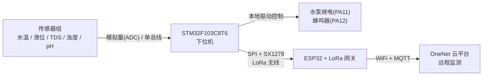

# SmartAquaculture · 基于 LoRa 无线传输的智能水产养殖系统

一套面向水产养殖场景的多参数水质监测与自动调控系统。下位机以 **STM32F103C8T6** 为核心完成五路水质参数采集与本地联动控制，通过 **LoRa（SX1278）** 将数据无线远传至 **ESP32 网关**，网关经 WiFi 上报 **OneNet（中国移动物联网开放平台）**，实现远程监测。

---

## 一、系统架构



**数据流**：传感器 → STM32 采集换算 → 组包为 `编号,温度,液位,TDS,浊度,pH` 字符串 → LoRa 发送（间隔 1 s）→ 网关 `sscanf` 解析 → MQTT 发布到 OneNet 属性上报主题。

---

## 二、监测参数与换算关系

下位机 `slave.c` 中完成四路 ADC（`PA0~PA3`）与 DS18B20 的读取与物理量换算。所有电压基准为 3.3 V，12 位 ADC（0~4095）。

| 参数 | 来源 | 换算公式 | 约束/范围 |
| --- | --- | --- | --- |
| 液位 `level` | ADC_PA0 | `(V0 - 0.1) × 270` | 截断至 0~100 %，保留 1 位小数 |
| TDS `tds` | ADC_PA1 | `360 × V1` | 单位 ppm |
| 浊度 `dirty` | ADC_PA2 | `-2000 × V2 + 3830` | 下限截断至 0，单位 NTU |
| pH `ph` | ADC_PA3 | `-5.634 × V3 + 16.413` | 保留 1 位小数 |
| 水温 `tem` | DS18B20 | `原始值 / 10.0` | 单位 ℃，`PB11` 单总线 |

> 上式均为线性拟合，不同批次传感器的实际系数存在离散性。**正式使用前请按你的模块实际数据手册或标定结果修正**。

### 本地联动控制阈值

逻辑同样位于 `下位机完整代码/slave/slave.c`：

- **水泵**：液位 `level > WARNING_PERCENT`（默认 `70`）时开启 `PA11` 高电平。
- **蜂鸣器**：满足任一条件即报警（PA12 低电平触发），温度 `>30 ℃` 或 `<10 ℃`、TDS `>1000 ppm`、浊度 `>1500 NTU`、pH `>7` 或 `<4`。

---

## 三、硬件清单与引脚接线

### 下位机：STM32F103C8T6（最小系统板）

| 外设 / 引脚 | STM32 引脚 | 说明 |
| --- | --- | --- |
| SX1278 SCK | PA5 | SPI1，波特率预分频 8（9 MHz） |
| SX1278 MISO | PA6 | SPI1 |
| SX1278 MOSI | PA7 | SPI1 |
| SX1278 NSS | PA4 | 软件控制片选 |
| SX1278 RESET | PB10 | 复位 |
| SX1278 DIO0 | PB0 | 中断/状态引脚 |
| SX1278 DIO1 | PB1 | 状态引脚 |
| SX1278 DIO3 | PA1 | 状态引脚 |
| SX1278 DIO4 | PA0 | 状态引脚 |
| DS18B20 DQ | PB11 | 单总线温度传感器 |
| 水位传感器 /OUT | PA0 | ADC1_IN0 |
| TDS 传感器 /OUT | PA1 | ADC1_IN1 |
| 浊度传感器 /OUT | PA2 | ADC1_IN2 |
| pH 传感器 /OUT | PA3 | ADC1_IN3 |
| 水泵继电器 | PA11 | 推挽输出，初始低电平 |
| 蜂鸣器 | PA12 | 推挽输出，低电平触发，初始高电平 |
| USART1（调试） | TX/RX | 串口打印日志，115200 |

### 网关：ESP32 + LoRa（Arduino ESP32 架）

LoRa 引脚定义在 `网关代码/lora02/lora02.ino`：

| 信号 | ESP32 GPIO | 备注 |
| --- | --- | --- |
| `SS`（NSS） | 41 | |
| `RST` | 1 | |
| `DI0` | 2 | |
| SPI SCK / MISO / MOSI | 38 / 39 / 40 | 自定义 SPI，`SPI.begin(38, 39, 40, -1)` |

---

## 四、LoRa 通信参数（两端必须一致）

这是本系统最常见的联调故障点，请保证下位机与网关配置严格匹配。

| 参数 | 下位机（STM32，`main.c`） | 网关（ESP32，`lora02.ino`） |
| --- | --- | --- |
| 频率 | `433000000`（433 MHz） | `433E6`（433 MHz） |
| 发射功率 | 20 dBm | 20 dBm |
| 带宽 | 索引 7 → 125 kHz | `125E3` |
| 扩频因子 SF | 12 | 12 |
| 编码率 CR | 4/5 | `setCodingRate4(5)` |
| 前导码 | `0x0005` | 长度 5 |
| 同步字 | — | `0x12` |

> ⚠️ **同步字需人工核对**：网关设置了 `setSyncWord(0x12)`，请确认下位机 SX1278 驱动中的同步字与之一致，否则两端无法互相识别。
> 若你的模块硬件频段不是 433 MHz（例如 470 MHz 或 868 MHz），需同时修改下位机 `main.c` 的 `stting` 与网关 `BAND` 宏。

上报周期：下位机每 **1 秒** 采集并发送一帧（`delay_ms(1000)` + 发送流程）。

---

## 五、OneNet 平台接入配置

网关 MQTT 相关配置集中在 `网关代码/lora02/WIFI_MQTT.cpp`：

```cpp
const char* ssid       = "你的WiFi名称";
const char* password   = "你的WiFi密码";

const char* mqttHostUrl  = "mqtts.heclouds.com";
const int   mqttPort     = 1883;

const char* mqttUser     = "<产品ID>";
const char* mqttClientId1 = "test1";              // 设备 1 名称
const char* mqttPassword1 = "<设备1的鉴权Token>";
const char* mqttClientId2 = "test2";              // 设备 2 名称
const char* mqttPassword2 = "<设备2的鉴权Token>";
```

配置步骤：

1. 在 OneNet 控制台创建**产品**（MQTT 旧版多协议接入），填入产品 ID。
2. 在产品下创建**物模型/数据流**属性，标识符需与代码一致：`tem`、`level`、`tds`、`dirty`、`ph`。
3. 创建**设备**，取得设备名称与 `key`，用 token 生成工具生成 `res`、`et`、`sign`（`version=2018-10-31&method=md5`）。
4. 将上述值填入 `WIFI_MQTT.cpp`，并同步修改发布主题宏：

   ```cpp
   #define ONENET_POST "$sys/<产品ID>/test%d/thing/property/post"
   ```

5. 编译烧录网关，串口监视器 115200 观察 `WiFi Connected` 与 `MQTT ... connected`。

> ⚠️ **安全提示**：若仓库为公开仓库，请勿直接提交真实的 WiFi 密码、产品 ID 与设备 Token。建议改为 `git update-index --skip-worktree` 本地保留，或使用头文件占位 + 本地覆写的方式管理。

### 多设备切换机制

OneNet 不允许同一个客户端凭据并发登录多台设备。网关在 `mqttPublishData()` 中通过对比**上一帧与当前帧的设备编号**决定是否断开重连：编号在 1↔2 之间切换时执行 `client.disconnect()` 后用另一套凭据重连。因此**当前仅支持编号 1、2 两台设备**，如需扩展需扩展该分支逻辑。

---

## 六、编译与烧录

### 下位机（Keil µVision）

1. 打开 `下位机完整代码/Project.uvprojx`（器件 STM32F103C8，需安装 STM32F1xx DFP 支持包）。
2. 确认 Object/Listing 输出目录存在，或使用 Tools 菜单重建。
3. 使用 ST-Link 下载，或生成 `.hex` 后用串口烧录。
4. 调试：`PA9/PA10` 串口 115200 输出版本号与 `sx1278 init OK` 等信息。

> 仓库内提供了 `keilkill.bat`，可在提交前清理 Keil 生成的中间文件（.adm 等大量临时文件）。

### 网关（Arduino IDE / PlatformIO）

1. 安装 **esp32** 开发板支持。
2. 依赖库：`LoRa`、`PubSubClient`、`ArduinoJson`（均可通过库管理器安装）。
3. 打开 `网关代码/lora02/`，选择对应 ESP32 开发板与端口，上传。
4. 串口监视器 115200 查看 `LoRa Receiver` 与收到的原始数据帧。

---

## 七、目录结构

```
.
├── README.md
├── readme.txt                             # 原始配置备忘说明
├── .gitignore
│
├── ProPrj_水质检测系统_2026-04-14.epro2    # 立创EDA(标准版) 工程源文件
├── SCH_Schematic1_2026-04-14.pdf          # 原理图 PDF
│
├── 下位机完整代码/                          # STM32F103C8T6 Keil 工程
│   ├── User/
│   │   ├── main.c                         # 主循环：初始化 + LoRa 发送 + 设备编号
│   │   ├── stm32f10x_it.c/.h              # 中断服务函数
│   │   └── stm32f10x_conf.h               # 库裁剪宏
│   ├── slave/
│   │   └── slave.c/.h                     # ★ 传感器采集、换算、阈值控制
│   ├── Hardware/
│   │   ├── AD.c/.h                        # ADC1 四通道单次采样
│   │   ├── ds18b20.c/.h                   # 单总线温度传感器
│   │   ├── LED.c/.h                       # 水泵 / 蜂鸣器 GPIO 控制
│   │   ├── sys.c/.h
│   │   ├── example/example_TX.c/.h        # ★ LoRa 数据组包与发送状态机
│   │   ├── radio/sx127x_driver.c/.h       # SX1278 驱动主体
│   │   └── HAL/SX127x_hal.c/.h            # ★ SPI 与引脚适配层
│   ├── System/                            # 延时、串口
│   ├── Library/                           # STM32 标准外设库 (SPL)
│   ├── Start/                             # CMSIS 内核与启动文件
│   ├── RTE/                               # Keil RTE 设备配置
│   ├── DebugConfig/
│   ├── keilkill.bat
│   └── Project.uvprojx / .uvoptx          # 工程与配置
│
└── 网关代码/lora02/
    ├── lora02.ino                         # ★ 网关主程序：LoRa 接收 + 解析 + 上报
    ├── WIFI_MQTT.cpp/.h                   # ★ WiFi/MQTT 连接与 OneNet 数据上报
    └── ...
```

---

## 八、使用注意事项（来自原 `readme.txt`）

1. **网关必须连接 WiFi**，账号密码在 `WIFI_MQTT.cpp` 中修改。
2. **OneNet 不允许一个单片机同时登录多台设备**；切换设备需要重新连接服务器。当前代码仅支持两台设备，更多设备需自行修改判断逻辑。
3. **水泵 / 蜂鸣器阈值**在下位机 `slave.c` 中调整，主要修改 `WARNING_PERCENT` 变量。
4. **设备编号**在 `main.c` 的 `EQUIPMENT_NUM` 宏中指定，当前仅支持编号 `1` 和 `2`。

---

## 九、常见问题排查

| 现象 | 可能原因 |
| --- | --- |
| 网关收不到任何数据 | 同步字（`0x12`）、SF/BW/前导码、频率（433 MHz）任一项两端不一致；检查 SPI 引脚接线 |
| 串口打印 `Starting LoRa failed!` | LoRa 模块未供电或 SPI 接线/引脚定义错误，此时程序在 `while(1)` 死等 |
| `DS18B20 init error!` | PB11 上拉/接触不良；温度恒为此前的默认值说明单总线通信失败 |
| `WiFi Failed` | SSID/密码错误，或仅支持 2.4 GHz 网络；重试在 20 次后放弃 |
| MQTT 反复 `connect failed` | 产品 ID、设备名或 Token 过期（`/et/` 时间戳到期需重新生成） |
| OneNet 有数据但全为 0 或恒偏 | 传感器换算系数与新出的传感器型号不符，需重新标定 `slave.c` 中的线性公式 |
| pH / 浊度出现负数 | 已在代码中做下限截断（≤0 取 0），若仍有异常请检查输入电压是否超出 0~3.3 V 量程 |

---

## 十、已知限制与改进方向

- 当前网关代码仅支持 **2 台**下位机设备，多设备需扩展 MQTT 切换逻辑。
- LoRa 为**单向**传输（下位机仅发送），不支持云端向下的遥控指令下发；如需远程控制，可为下位机增加 LoRa RX 通道并在 `MQTT_callback()` 中处理下行消息。
- 数据上报缺少重传与校验机制；建议在协议中加入帧头、长度、CRC 校验。
- 传感器换算系数为线性拟合近似，实际部署前应使用标准溶液重新标定。
- 后续可拓展方向：设备低电量/离线检测、断网期间历史数据缓存与补传。

---

## 参考资料

- STM32F10x Standard Peripheral Library（SPL）
- SX1276/77/78 LoRa 收发器数据手册
- OneNet 物联网开放平台 MQTT 接入文档
- LoRa SX127x 驱动 © 2019 AIThinker / Specter（`example_TX.c` 注释声明为参考 demo，不保证商用稳定性）
- DS18B20 驱动 © 辰哥单片机设计 · 异方辰电子工作室
